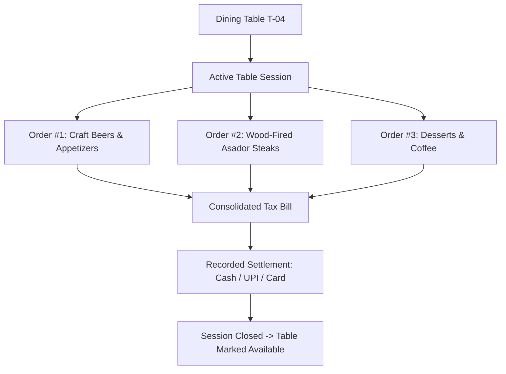

# L'Asador – Grill & Brew | Billing & Payment Settlement Guide

## 1. Overview
The Billing and Settlement subsystem consolidates all orders placed across an active dining table session into a single, compliant tax invoice for **L'Asador – Grill & Brew**, Sector 82, JLPL Industrial Area, Mohali, Punjab.

The module provides multi-tender payment recording, statutory Indian Goods & Services Tax (GST) calculations, thermal receipt generation, and table turnover automation.

---

## 2. Table Session Aggregation Architecture

A dining party may place multiple successive orders over the course of an evening (e.g., initial round of craft beers, appetizers, main grill steaks, dessert, and digestifs).



### Table Workflow:
1. **Bill Generation**: When the guest requests their bill or the floor manager clicks **Generate Bill**, the system queries all non-cancelled orders associated with the current `table_session_id`.
2. **Item Consolidation**: All line items, portion sizes, and modifiers are aggregated.
3. **Subtotal & Tax Calculations**:
   - `subtotal`: Sum of all item line subtotals.
   - `cgst_amount`: Subtotal × 2.5% (rounded to 2 decimal places).
   - `sgst_amount`: Subtotal × 2.5% (rounded to 2 decimal places).
   - `total_tax`: CGST + SGST (5.0% statutory restaurant GST).
   - `total_amount`: Subtotal + total_tax - discount_amount.
4. **Draft Creation**: Bill is stored with status `draft`.

---

## 3. Statutory GST Compliance (Mohali, Punjab)

L'Asador operates as an air-conditioned standalone restaurant serving food and beverages in Mohali, Punjab, falling under the standard 5% restaurant GST regime:

| Tax Component | Rate | Jurisdiction | Notes |
| :--- | :---: | :--- | :--- |
| **Central GST (CGST)** | 2.5% | Government of India | Itemized on all customer receipts |
| **State GST (SGST)** | 2.5% | Government of Punjab | Itemized on all customer receipts |
| **Total Statutory GST** | **5.0%** | Combined | Input tax credit (ITC) restricted under Section 9(1) |

*Note: The system supports configurable tax rates in `tax_settings` should future state regulations change.*

---

## 4. Multi-Tender Payment Settlement

Managers settle bills via the Billing Console (`/admin/billing`):

| Tender Code | Payment Method | Typical Usage | Notes |
| :--- | :--- | :--- | :--- |
| `cash` | Cash Currency | Currency notes tendered at table | Amount tendered & change computed |
| `upi` | Dynamic UPI QR | PhonePe, Google Pay, Paytm, BHIM | Direct bank-to-bank UPI transfer |
| `card` | Credit / Debit Card | Visa, Mastercard, RuPay | Processed on wireless POS EDC terminal |
| `pos` | Bank POS Terminal | Integrated pin-pad or batch settlement | Reference ID recorded for reconciliation |

### Settlement Enforcement:
- Recording payment executes atomically:
  1. Creates an immutable `payments` record with `payment_method`, `amount`, and `processed_by` staff profile ID.
  2. Updates `bills.status = 'paid'` with timestamp `paid_at`.
  3. Updates `table_sessions.status = 'completed'` with timestamp `ended_at`.
  4. Resets `dining_tables.status = 'available'` (or `dirty` for busser clearance).
  5. Records an immutable entry in `audit_logs`.

---

## 5. 80mm ESC/POS Thermal Receipt Printing

The billing console features a native thermal receipt generator formatted for 80mm (3-1/8") standard POS receipt printers (Epson, Star Micronics, Citizen):

### Receipt Layout Spec:
```
==========================================
          L'ASADOR – GRILL & BREW         
  Sector 82, JLPL Industrial Area, Mohali 
             Punjab – 160055              
          GSTIN: 03AAAAA0000A1Z5          
==========================================
Invoice #: INV-20261121-0042
Date: 21 Nov 2026, 09:14 PM
Table: Table 04 (Ground Hearth)
Staff: Simranjit Singh (Manager)
------------------------------------------
ITEM              QTY    PRICE      TOTAL
------------------------------------------
Smoked Ribeye 400g  1  1,750.00  1,750.00
  + Chimichurri                      80.00
Mohali Blonde Pint  2    350.00    700.00
Truffle Fries       1    380.00    380.00
------------------------------------------
Subtotal:                        ₹2,910.00
CGST (2.5%):                        ₹72.75
SGST (2.5%):                        ₹72.75
Total Tax (5.0%):                  ₹145.50
------------------------------------------
GRAND TOTAL:                     ₹3,055.50
------------------------------------------
Settled via: UPI (Ref: UPI-984210)
Status: PAID
==========================================
       THANK YOU FOR DINING AT L'ASADOR   
      Crafted with Smoke, Wood & Hops     
==========================================
```

- Accessible via the **Print Receipt** button in the billing console.
- Formatted with CSS `@media print` rules: hides browser headers, margins, and toolbars, ensuring clean, edge-to-edge printing.
