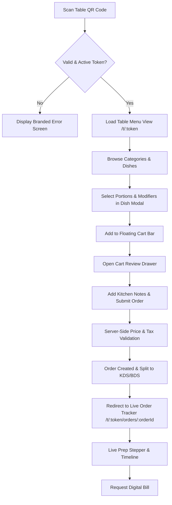

# L'Asador – Grill & Brew | Customer QR Ordering Guide

## 1. Overview
The customer ordering journey is a zero-friction, mobile-optimized Progressive Web Application (PWA) accessible by scanning any active table QR code at **L'Asador – Grill & Brew**, Mohali.

No app installation, account creation, or invasive personal information is required. Diners simply scan, select their dishes, specify dietary preferences, and submit orders directly to the kitchen and bar.

---

## 2. Customer Journey Flow

---

## 3. Screen-by-Screen Breakdown

### 3.1 QR Landing Page (`/t/[token]`)
- **Table Context Header**: Prominently displays *"Table T-04 — Ground Hearth"* so the guest has immediate confidence they are ordering for their exact physical table.
- **Search & Dietary Filters**: Dynamic filter pills allow guests to filter by:
  - All Items
  - Vegetarian (`veg`)
  - Non-Vegetarian (`non_veg`)
  - Craft Brews & Cocktails (`contains_alcohol`)
- **Sticky Category Carousel**: Smooth-scrolling horizontal navigation that stays pinned as the guest scrolls through categories like *Asador Grill*, *Craft Brews*, and *Wood-Fired Plates*.
- **Item Cards**: Rich cards with high-resolution imagery, dietary indicators, prep time, station badge, and clear pricing.

### 3.2 Dish Customization Modal
When a guest taps a dish:
1. **Portion Selection**: If the item has variants (e.g. *Mohali Blonde Ale Pint vs. Growler* or *Smoked Ribeye 250g vs. 400g*), portion cards display the exact price.
2. **Mandatory & Optional Modifiers**:
   - Radio buttons for single-choice mandatory options (e.g. *Steak Doneness: Medium-Rare*).
   - Checkboxes with price deltas for multi-choice add-ons (e.g. *Truffle Butter +₹150, Extra Chimichurri +₹80*).
   - Validation prevents adding to cart until all mandatory groups (`min_selection: 1`) are satisfied.
3. **Special Prep Notes**: Free-text field for dietary requests (e.g., *"Less spicy", "No garlic", "Garnish with rosemary"*).

### 3.3 Sticky Cart Bar & Review Drawer
- **Persistent Bottom Bar**: Displays item count and subtotal preview with animated feedback on item additions.
- **Slide-up Review Drawer**:
  - Full itemized list with chosen portion variants and modifier breakdowns.
  - Increment/decrement quantity controls.
  - Order-level special requests.
  - Price summary showing subtotal and estimated statutory 5% GST (2.5% CGST + 2.5% SGST).

---

## 4. Server-Side Security & Price Validation

To eliminate client-side tampering (e.g., modifying cart prices in JavaScript):
1. **Zero Trust on Client Subtotals**: The server receives only product IDs, variant IDs, modifier IDs, quantities, and notes.
2. **Canonical Price Re-lookup**: The Server Action (`submitCustomerOrder`) queries the database directly to fetch current prices for all referenced products, variants, and modifiers.
3. **Statutory Tax Computation**: Calculates statutory 5% GST (2.5% CGST + 2.5% SGST) on the server.
4. **Historical Price Snapshotting**: The verified unit prices, modifier prices, line subtotals, and GST amounts are written into `order_items` as immutable numeric records. If menu prices change tomorrow, past orders and bills remain 100% accurate.
5. **Idempotency Protection**: Every checkout generates a unique client UUID (`idempotency_key`). Rapid double-taps on weak cellular connections will not create duplicate orders or double-charge the guest.

---

## 5. Live Order Tracking (`/t/[token]/orders/[orderId]`)

Upon submission, the customer is instantly redirected to the live tracking page:
- **Status Stepper**:
  - `new`: Order received and assigned to queue.
  - `accepted`: Verified by floor manager.
  - `preparing`: Fired on grill, fry station, or bar tap.
  - `ready`: Plated or poured, ready for table runner.
  - `completed`: Served to table.
- **Station-Level Status Chips**: Guests can see individual progress for their drinks and grill items independently.
- **Real-Time Polling & Realtime Sync**: Automatically refreshes every 5 seconds to provide up-to-the-minute status updates.
- **Request Bill Button**: Once dining is complete, guests tap **Request Bill** to notify floor staff that they are ready to settle.
