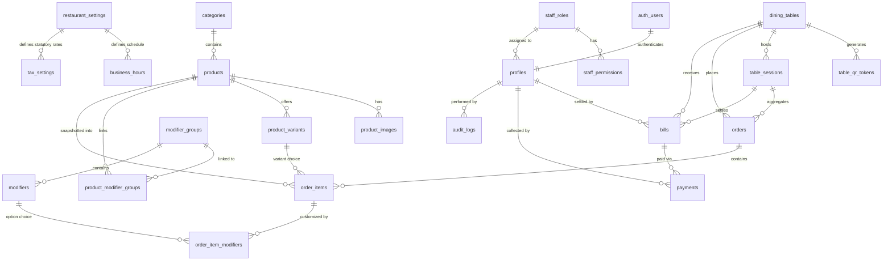

# L'Asador – Grill & Brew | Database Schema Reference
**Location:** Sector 82, JLPL Industrial Area, Mohali, Punjab, India  
**System Type:** Dedicated Single-Restaurant Architecture (Zero Multi-Tenancy)  
**Database Engine:** PostgreSQL via Supabase  
**Document Version:** 2.0.0 (Phase 2 Foundation)  

---

## 1. Architectural Philosophy

1. **Single-Restaurant Isolation:** All database tables and entities are strictly dedicated to L'Asador – Grill & Brew. No `tenant_id`, `organization_id`, or multi-tenant abstractions exist.
2. **Normalized Relational Design:** Enforces referential integrity with explicit foreign keys and cascade/restrict rules.
3. **Auditable Financial Snapshots:** Menu price changes do not rewrite historical order items or bills. Order items and modifiers snapshot names and prices at the moment of order submission.
4. **Hashed QR Secret Storage:** Physical table QR codes store a high-entropy secret whose SHA-256 hash is verified against `table_qr_tokens`. Plaintext QR secrets are never persisted in the database.
5. **Station-Based Routing:** Preparation items are routed to dedicated operational stations (`kitchen_grill`, `kitchen_fry`, `kitchen_pantry`, `bar_taps`, `bar_cocktails`).

---

## 2. Entity-Relationship Overview

---

## 3. Comprehensive Table Catalog

### A. Restaurant Configuration

#### `restaurant_settings`
Singleton row (`id = 1`) maintaining the operational metadata of L'Asador.
- `id` (INTEGER, PK, CHECK `id = 1`): Singleton record identifier.
- `name` (TEXT, NOT NULL): Restaurant trade name ("L'Asador – Grill & Brew").
- `tagline` (TEXT): Subtitle ("Artisanal Wood-Fired Grill & Craft Microbrewery").
- `description` (TEXT): Concept narrative.
- `address_line1` (TEXT, NOT NULL): Primary street address (Sector 82, JLPL Industrial Area).
- `address_line2` (TEXT): Secondary address details.
- `city` (TEXT, NOT NULL): "Mohali".
- `state` (TEXT, NOT NULL): "Punjab".
- `pincode` (TEXT, NOT NULL): "140308".
- `country` (TEXT, NOT NULL): "India".
- `phone` (TEXT, NOT NULL): Operational contact phone.
- `email` (TEXT, NOT NULL): Reservations email.
- `gst_number` (TEXT): Statutory GSTIN.
- `fssai_license` (TEXT): FSSAI food safety license number.
- `currency` (TEXT, NOT NULL, DEFAULT `'INR'`).
- `currency_symbol` (TEXT, NOT NULL, DEFAULT `'₹'`).
- `timezone` (TEXT, NOT NULL, DEFAULT `'Asia/Kolkata'`).
- `is_ordering_enabled` (BOOLEAN, NOT NULL, DEFAULT `true`): Emergency ordering kill-switch.
- `created_at` / `updated_at` (TIMESTAMPTZ, NOT NULL).

#### `business_hours`
Defines regular weekly operating hours.
- `id` (UUID, PK, DEFAULT `gen_random_uuid()`).
- `day_of_week` (INTEGER, NOT NULL, CHECK `day_of_week BETWEEN 0 AND 6`): 0=Sunday, 1=Monday...
- `day_name` (TEXT, NOT NULL): Name of weekday.
- `open_time` (TIME, NOT NULL): Daily opening time.
- `close_time` (TIME, NOT NULL): Daily closing time.
- `is_closed` (BOOLEAN, NOT NULL, DEFAULT `false`).
- `created_at` / `updated_at` (TIMESTAMPTZ, NOT NULL).
- **Constraints:** `UNIQUE (day_of_week)`.

#### `tax_settings`
Statutory Indian GST and service charge rates.
- `id` (UUID, PK, DEFAULT `gen_random_uuid()`).
- `name` (TEXT, NOT NULL): "CGST", "SGST", "Service Charge".
- `code` (TEXT, NOT NULL, UNIQUE): Unique reference identifier.
- `rate_percentage` (NUMERIC(5,2), NOT NULL, CHECK `>= 0`): Percentage rate.
- `is_active` (BOOLEAN, NOT NULL, DEFAULT `true`).
- `is_mandatory` (BOOLEAN, NOT NULL, DEFAULT `true`).
- `is_inclusive` (BOOLEAN, NOT NULL, DEFAULT `false`): Whether rate is baked into menu price.
- `display_order` (INTEGER, NOT NULL, DEFAULT `0`).

---

### B. Staff & Access Control

#### `staff_roles`
Reference table defining permitted operational roles.
- `role` (`staff_role` ENUM: `'owner'`, `'admin'`, `'manager'`, `'kitchen'`, `'bar'`, PK).
- `name` (TEXT, NOT NULL): Display title.
- `description` (TEXT, NOT NULL): Scope of responsibility.

#### `staff_permissions`
Granular permission keys assigned to each role.
- `id` (UUID, PK).
- `role` (`staff_role`, FK `staff_roles(role)` ON DELETE CASCADE).
- `permission_key` (TEXT, NOT NULL): e.g., `'settings:manage'`, `'menu:manage'`, `'bills:settle'`.
- `description` (TEXT).
- **Constraints:** `UNIQUE (role, permission_key)`.

#### `profiles`
Staff user accounts linked directly to Supabase `auth.users`.
- `id` (UUID, PK, FK `auth.users(id)` ON DELETE CASCADE).
- `email` (TEXT, NOT NULL).
- `full_name` (TEXT).
- `role` (`staff_role`, NOT NULL, DEFAULT `'kitchen'`).
- `phone` (TEXT).
- `is_active` (BOOLEAN, NOT NULL, DEFAULT `true`).
- `last_login_at` (TIMESTAMPTZ).
- `created_at` / `updated_at` (TIMESTAMPTZ, NOT NULL).

---

### C. Menu Management

#### `categories`
Top-level menu divisions.
- `id` (UUID, PK).
- `name` (TEXT, NOT NULL): e.g., "Wood-Fired Steaks", "Craft Draft Taps".
- `slug` (TEXT, NOT NULL, UNIQUE).
- `description` (TEXT).
- `station` (`item_station` ENUM, DEFAULT `'kitchen_grill'`).
- `display_order` (INTEGER, NOT NULL, DEFAULT `0`).
- `is_active` (BOOLEAN, NOT NULL, DEFAULT `true`).

#### `products`
Individual culinary and beverage offerings.
- `id` (UUID, PK).
- `category_id` (UUID, NOT NULL, FK `categories(id)` ON DELETE RESTRICT).
- `name` (TEXT, NOT NULL).
- `slug` (TEXT, NOT NULL, UNIQUE).
- `description` (TEXT).
- `base_price` (NUMERIC(10,2), NOT NULL, CHECK `>= 0`).
- `dietary` (`dietary_type` ENUM: `'veg'`, `'non_veg'`, `'egg'`, `'vegan'`).
- `station` (`item_station` ENUM: `'kitchen_grill'`, `'kitchen_fry'`, `'kitchen_pantry'`, `'bar_taps'`, `'bar_cocktails'`).
- `is_available` (BOOLEAN, NOT NULL, DEFAULT `true`): 86/out-of-stock toggle.
- `is_featured` (BOOLEAN, NOT NULL, DEFAULT `false`).
- `display_order` (INTEGER, NOT NULL, DEFAULT `0`).

#### `product_images`
Product visual assets.
- `id` (UUID, PK).
- `product_id` (UUID, NOT NULL, FK `products(id)` ON DELETE CASCADE).
- `image_url` (TEXT, NOT NULL).
- `alt_text` (TEXT).
- `is_primary` (BOOLEAN, NOT NULL, DEFAULT `false`).
- `display_order` (INTEGER, NOT NULL, DEFAULT `0`).

#### `product_variants`
Portion sizes, weights, or pour sizes.
- `id` (UUID, PK).
- `product_id` (UUID, NOT NULL, FK `products(id)` ON DELETE CASCADE).
- `name` (TEXT, NOT NULL): e.g., "350g Cut", "Pint (500ml)".
- `sku` (TEXT).
- `price` (NUMERIC(10,2), NOT NULL, CHECK `>= 0`).
- `is_available` (BOOLEAN, NOT NULL, DEFAULT `true`).
- `display_order` (INTEGER, NOT NULL, DEFAULT `0`).
- **Constraints:** `UNIQUE (product_id, name)`.

#### `modifier_groups` & `modifiers`
Customization options (e.g., Doneness, Sauces, Add-ons).
- `modifier_groups`: `id`, `name`, `description`, `min_selections`, `max_selections`, `is_required`.
- `modifiers`: `id`, `modifier_group_id` (FK ON DELETE CASCADE), `name`, `price_delta`, `is_available`, `display_order`.
- `product_modifier_groups`: Join table mapping groups to products with display order.

---

### D. Table & QR Token Management

#### `dining_tables`
Physical restaurant tables and seating zones.
- `id` (UUID, PK).
- `table_number` (TEXT, NOT NULL, UNIQUE): e.g., "T-01", "BAR-01", "PATIO-01".
- `label` (TEXT): Human-readable table designation.
- `zone` (TEXT, NOT NULL, DEFAULT `'Main Dining'`).
- `capacity` (INTEGER, NOT NULL, CHECK `capacity > 0`).
- `is_active` (BOOLEAN, NOT NULL, DEFAULT `true`).

#### `table_qr_tokens`
Cryptographic QR token lifecycle.
- `id` (UUID, PK).
- `table_id` (UUID, NOT NULL, FK `dining_tables(id)` ON DELETE CASCADE).
- `token_hash` (TEXT, NOT NULL, UNIQUE): SHA-256 hash of token; plaintext secrets are never stored.
- `is_active` (BOOLEAN, NOT NULL, DEFAULT `true`).
- `created_at` / `revoked_at` (TIMESTAMPTZ).
- **Constraints:** Only 1 active token permitted per table via partial unique index.

#### `table_sessions`
Active dining session grouping orders placed at a table.
- `id` (UUID, PK).
- `table_id` (UUID, NOT NULL, FK `dining_tables(id)` ON DELETE RESTRICT).
- `session_token_hash` (TEXT, NOT NULL, UNIQUE).
- `guest_count` (INTEGER, DEFAULT 1).
- `status` (TEXT, NOT NULL, CHECK `status IN ('active', 'billing', 'closed')`).
- `opened_at` / `closed_at` (TIMESTAMPTZ).

---

### E. Orders, Billing & Auditing Foundation

#### `orders`
Order header records.
- `id` (UUID, PK).
- `order_number` (TEXT, NOT NULL, UNIQUE): e.g., "ORD-20261120-001".
- `table_id` (UUID, NOT NULL, FK `dining_tables(id)` ON DELETE RESTRICT).
- `session_id` (UUID, NOT NULL, FK `table_sessions(id)` ON DELETE RESTRICT).
- `status` (`order_status`: `'new'`, `'accepted'`, `'preparing'`, `'ready'`, `'completed'`, `'cancelled'`).
- `idempotency_key` (TEXT, NOT NULL, UNIQUE): Prevents duplicate submissions.
- `subtotal`, `tax_total`, `service_charge`, `discount_total`, `total_amount` (NUMERIC(10,2)).
- `special_notes` (TEXT).

#### `order_items` & `order_item_modifiers`
Line items with frozen pricing snapshots and prep routing.
- `order_items`: Snapshots `product_name_snapshot`, `variant_name_snapshot`, `unit_price_snapshot`, `quantity`, `subtotal`, `station`, `prep_status` (`'pending'`, `'preparing'`, `'ready'`, `'served'`, `'cancelled'`).
- `order_item_modifiers`: Snapshots `modifier_name_snapshot`, `price_delta_snapshot`.

#### `bills` & `payments`
Financial billing settlement foundation.
- `bills`: `bill_number`, `session_id`, `table_id`, `status` (`'open'`, `'requested'`, `'settled'`, `'voided'`), itemized tax totals, `settled_by` (FK `profiles`).
- `payments`: `bill_id`, `payment_method` (`'cash'`, `'upi_qr'`, `'card'`, `'pos_machine'`), `status`, `amount`, `transaction_reference`, `collected_by` (FK `profiles`).

#### `audit_logs`
Immutable administrative event log.
- `id` (UUID, PK).
- `actor_id` (UUID, FK `profiles(id)` ON DELETE SET NULL).
- `action` (TEXT, NOT NULL): e.g., `'price_change'`, `'revoke_qr'`, `'role_assignment'`.
- `entity` (TEXT, NOT NULL).
- `entity_id` (TEXT).
- `details` (JSONB).
- `ip_address` (TEXT).
- `created_at` (TIMESTAMPTZ).
