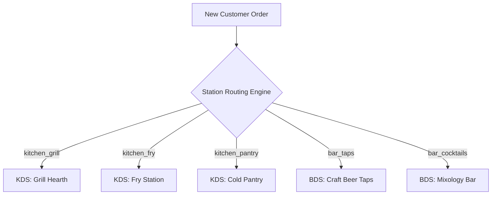

# L'Asador – Grill & Brew | Kitchen & Bar Display Systems (KDS / BDS)

## 1. Overview
The Kitchen Display System (KDS) and Bar Display System (BDS) are specialized, high-contrast, touch-optimized interfaces designed for kitchen line cooks and bartenders at **L'Asador – Grill & Brew**, Sector 82, JLPL Industrial Area, Mohali, Punjab.

By replacing noisy paper ticket printers with interactive digital screens, L'Asador ensures zero lost tickets, precise prep-time tracking, and automated item-by-item expediting.

---

## 2. Station Architecture & Routing

Every product is routed according to its assigned preparation station:

### Station URLs:
- **Kitchen Display System (KDS)**: `/kitchen` (accessible to `owner`, `admin`, `manager`, `kitchen` roles).
- **Bar Display System (BDS)**: `/bar` (accessible to `owner`, `admin`, `manager`, `bar` roles).

---

## 3. Visual Ergonomics & Hardware Recommendations

### 3.1 Recommended Hardware
- **Kitchen Line**: 21.5" or 24" IP65 water-resistant, grease-resistant all-in-one touchscreen PC or commercial Android tablet mounted on VESA articulated arms above prep counters.
- **Bar Station**: 12.9" or 15.6" sealed tablet or touch terminal near tap faucets and well ice bins.
- **Audio Output**: Connected amplified external speaker or soundbar mounted above ambient kitchen hood fans.

### 3.2 Visual Design System
- **Dark, High-Contrast Palette**: `#0C0A09` rich black background with crisp white and amber typography. Reduces glare under harsh kitchen spotlights.
- **Large Tap Targets**: Action buttons are minimum 48px × 48px to support gloved fingers or bump sticks.
- **Ticket Color Aging (Elapsed Timers)**:
  - **Green (Normal)**: 0 to 10 minutes elapsed since order placement.
  - **Amber (Warning)**: 10 to 20 minutes elapsed. Cooks are alerted to expedite.
  - **Red Flashing (Urgent)**: > 20 minutes elapsed. High-priority ticket requiring immediate manager attention.

---

## 4. Item-Level vs. Order-Level State Machine

In high-volume kitchen operations, different items on the same order finish at different times (e.g. craft beers pour in 30 seconds; a medium-rare tomahawk steak takes 16 minutes).

### State Transitions:
1. **Item-Level Progress**:
   - `pending` -> Cook taps item to mark `preparing` (turns amber).
   - `preparing` -> Cook taps item to mark `ready` (turns emerald, strikethrough).
2. **Automated Parent Order Synchronization**:
   - When **at least one item** begins prep, the parent order transitions to `preparing`.
   - When **all items** in the order reach `ready`, the parent order automatically transitions to `ready` across the floor runner console.
   - When floor runners deliver all dishes and mark items `served`, the parent order transitions to `completed`.

---

## 5. Web Audio API Acoustic Notification

To alert kitchen and bar staff during high-energy grill shifts:
- The system incorporates a non-blocking synthetic chime synthesized via the browser's native **Web Audio API**:
  - Dual-frequency pleasant tone (587.33 Hz [D5] resolving to 880 Hz [A5]).
  - Exponential decay envelope preventing harsh digital distortion.
  - Fires automatically whenever a new incoming ticket is detected by the polling / WebSocket listener.
- Staff can test the speaker system at any time by clicking the **Audio Test** button in the header bar.

---

## 6. Staff Role Access & Boundary Security

| Role | Access to /kitchen | Access to /bar | Permission Flags |
| :--- | :---: | :---: | :--- |
| `owner` | Yes | Yes | All operational controls |
| `admin` | Yes | Yes | All operational controls |
| `manager` | Yes | Yes | `kitchen:view`, `kitchen:update`, `bar:view`, `bar:update` |
| `kitchen` | Yes | **No** (Redirected) | `kitchen:view`, `kitchen:update` |
| `bar` | **No** (Redirected) | Yes | `bar:view`, `bar:update` |

Cross-station tampering is blocked at both the Server Action and UI route level. A kitchen cook cannot advance bar cocktail tickets, and a bartender cannot mark wood-fired grill steaks.
