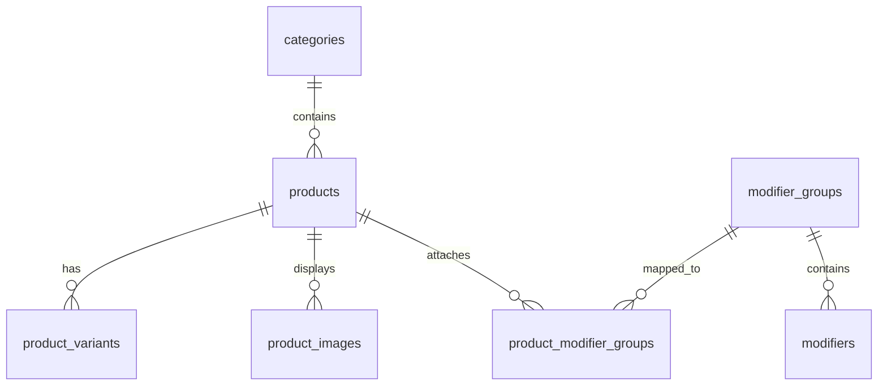

# L'Asador – Grill & Brew | Menu Management Guide

## 1. Overview
The Menu Management module powers both the customer-facing QR ordering application and the back-of-house kitchen/bar routing for **L'Asador – Grill & Brew**, Sector 82, JLPL Industrial Area, Mohali, Punjab.

The system is designed with a strict relational hierarchy that guarantees historical pricing integrity, kitchen station dispatching, dietary transparency, and dynamic variant configurations.

---

## 2. Menu Relational Architecture

The menu is structured across 6 normalized PostgreSQL tables:

### Table Definitions & Roles
1. **`categories`**: Top-level menu groupings (e.g., *Artisan Grill & Steaks*, *Craft Brews & Taps*, *Wood-Fired Small Plates*, *Handcrafted Cocktails*, *Sides & Sauces*).
   - Attributes: `name`, `slug`, `description`, `display_order`, `is_active`.
2. **`products`**: The core culinary items.
   - Attributes: `name`, `slug`, `category_id`, `base_price` (in ₹ INR), `dietary_type` (`veg`, `non_veg`, `contains_alcohol`, `vegan`, `egg`), `prep_station` (`kitchen_grill`, `kitchen_fry`, `kitchen_pantry`, `bar_taps`, `bar_cocktails`), `is_available`, `is_active`.
3. **`product_variants`**: Size or portion variations (e.g., *Craft Beer 330ml / 500ml / Pitcher*, *Steak 250g / 400g*).
   - Attributes: `product_id`, `name`, `price_override` (if null, defaults to product base price), `is_available`, `display_order`.
4. **`modifier_groups`**: Groupings of options or add-ons (e.g., *Meat Temperature*, *Side Choice*, *Choice of Wood Smoke*, *Craft Beer Temperature*).
   - Attributes: `name`, `min_selection` (e.g., 1 for mandatory meat doneness), `max_selection` (e.g., 1 for single choice, >1 for toppings).
5. **`modifiers`**: Individual add-on choices within a group.
   - Attributes: `group_id`, `name`, `price_delta` (e.g., ₹0 for standard doneness, +₹150 for truffle butter), `is_available`.
6. **`product_modifier_groups`**: Many-to-many junction between products and modifier groups with custom display order.

---

## 3. Preparation Station Routing

Every product is tagged with an immutable preparation station (`prep_station`). When an order is placed, items are automatically partitioned for real-time display:

| Prep Station | Display System | Typical Items | Station Focus |
| :--- | :--- | :--- | :--- |
| `kitchen_grill` | KDS (Kitchen) | Steaks, smoked pork belly, grilled prawns | Wood/charcoal fire, doneness control |
| `kitchen_fry` | KDS (Kitchen) | Truffle fries, wings, onion rings | Deep fryers, timers |
| `kitchen_pantry` | KDS (Kitchen) | Artisanal salads, sourdough bread, desserts | Cold larder, prep table |
| `bar_taps` | BDS (Bar) | Mohali Blonde, Amber Ale, Stout | Draft tap line control, pour sizes |
| `bar_cocktails` | BDS (Bar) | Smoked Old Fashioned, Craft G&T | Mixology station, garnishes, glassware |

---

## 4. Administrative Operations

Administrators and managers access the menu management console at `/admin/menu`.

### 4.1 Creating a New Product
1. Navigate to **Admin Console -> Menu Management**.
2. Select the **Products** tab and click **Add Product**.
3. Provide:
   - **Product Name** & **Category**
   - **Base Price** (e.g., ₹850.00)
   - **Dietary Classification** (Veg, Non-Veg, Egg, Alcohol)
   - **Preparation Station** (`kitchen_grill`, `bar_taps`, etc.)
   - **Description** & **Availability Status**
4. Save the product. The item immediately becomes available in the customer QR menu if marked active and available.

### 4.2 Configuring Portions / Variants
1. On the product card or row, click **Variants**.
2. Add portion options:
   - Example: Pint (₹350.00), Stein (₹550.00), Growler (₹1,200.00).
3. If variants are present, the customer UI prompts the diner to select their preferred portion before adding to the cart.

### 4.3 Attaching Modifiers
1. Click **Modifiers** on the product row.
2. Select existing modifier groups (e.g., *Steak Temperature: Rare, Medium-Rare, Medium, Well-Done*).
3. Specify whether selection is mandatory (`min_selection: 1`).
4. Save mappings.

### 4.4 Real-Time 86 / Out of Stock Toggles
- Floor managers can toggle the **Available / 86** switch in real-time.
- Unavailable items are instantly greyed out on customer devices and cannot be added to active carts.

### 4.5 Safe Deletion vs. Archival
- **Historical Order Integrity**: If a product has ever been ordered in `order_items`, database foreign key constraints (`ON DELETE RESTRICT`) prevent hard deletion.
- In such cases, the system automatically marks `is_available = false` and `is_active = false`, safely archiving the item without corrupting historical billing or analytics records.
