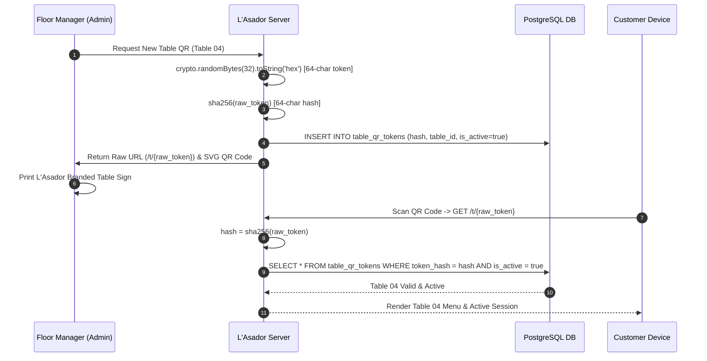

# L'Asador – Grill & Brew | Table & QR Code System Guide

## 1. Overview
The Table Management & QR Code subsystem provides cryptographic, physical table binding for dine-in guests at **L'Asador – Grill & Brew**, Sector 82, JLPL Industrial Area, Mohali, Punjab.

By replacing static table identifiers with high-entropy cryptographic tokens and irreversible SHA-256 database hashes, L'Asador prevents table-spoofing, unauthorized order injection, and token scraping attacks.

---

## 2. Table Layout & Zoning

The restaurant floor plan is divided into 3 distinct operational zones:

| Zone Code | Zone Name | Description | Capacity |
| :--- | :--- | :--- | :--- |
| `ground` | Ground Hearth | Main dining floor surrounding the central wood-fired asador grill. | Tables 1–12 (2–6 tops) |
| `mezzanine` | Mezzanine Lounge | Elevated private dining & acoustic lounge overlooking the hearth. | Tables M1–M6 (4–8 tops) |
| `brewery_deck` | Brewery Deck | Outdoor covered deck adjacent to the microbrewery fermentation tanks. | Tables B1–B8 (2–4 tops) |

---

## 3. Cryptographic Token Architecture

Traditional QR systems embed sequential table IDs (e.g. `table=5`), allowing malicious actors to submit fraudulent orders to other guests' bills. L'Asador implements a secure cryptographic token architecture:

### Key Security Properties:
1. **High Entropy**: Tokens are 256-bit (32 bytes) random hex strings generated using `node:crypto`.
2. **Zero Plaintext Storage**: The database only stores `token_hash = SHA-256(raw_token)`. Even with complete database read access, an attacker cannot reverse hashes into valid QR scan URLs.
3. **Instant Revocation**: If a physical QR stand is compromised or damaged, managers can revoke the active token with one click. Existing sessions remain safe, and a new token is immediately issued.

---

## 4. Standalone Vector SVG QR Code Engine

L'Asador features an in-house, zero-dependency QR code generator (`src/lib/utils/qr.ts`):
- **Model 2 QR Matrix Generation**: Native Reed-Solomon Error Correction Code (Level M / Q) with bitmask optimization.
- **Pure SVG Vector Graphics**: Generates crisp, scalable vector SVG files that render flawlessly at any print resolution without raster blur.
- **Brand Palette Integration**: Encoded with L'Asador charcoal `#14110F` and warm amber `#D97706` styling for high optical contrast on smartphones in dim ambient lighting.

---

## 5. Administrative Operations (`/admin/tables`)

1. **Viewing Floor Status**: The table grid displays all tables with real-time status pills (`available`, `occupied`, `reserved`, `dirty`).
2. **Generating / Previewing QR**:
   - Click **View QR** on any table card.
   - An interactive modal displays the vector SVG QR code with table metadata.
3. **Printing Table Display Labels**:
   - Click **Print Label** inside the QR modal.
   - Generates a styled, branded 100mm × 150mm table placard formatted with:
     - L'Asador – Grill & Brew Header & Mohali location.
     - Table Number & Floor Zone.
     - Crisp QR Code.
     - Clear customer instructions (*"Scan with your camera to explore our artisanal wood-fired menu and craft brews"*).
4. **Exporting SVG**: Click **Download SVG** for graphic designers creating custom brass or wood table stands.
5. **Token Rotation**: Click **Rotate QR Token** to instantly deactivate the current token and generate a fresh one.

---

## 6. Physical Placement & Anti-Tamper Protocol

To protect table QR codes on the restaurant floor:
1. **Acrylic / Brass Enclosures**: QR codes should be housed inside weighted, sealed acrylic or brushed brass stands with tamper-evident base seals.
2. **Pre-Shift Physical Verification**: Floor managers must perform a rapid visual inspection during opening procedures to ensure no foreign stickers have been overlaid on the table QR placards.
3. **Immediate Re-issuance**: If any sticker peeling or physical damage is observed, the table token should be rotated immediately from the admin console and a new label printed.
